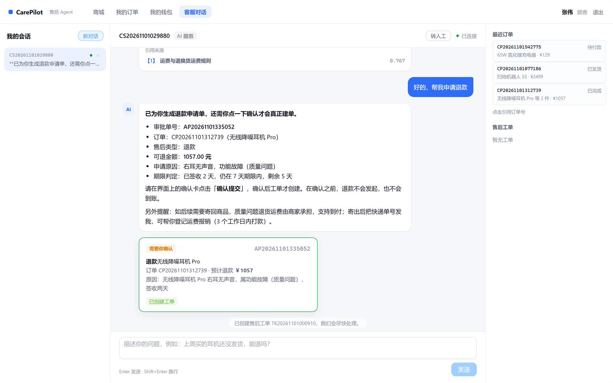
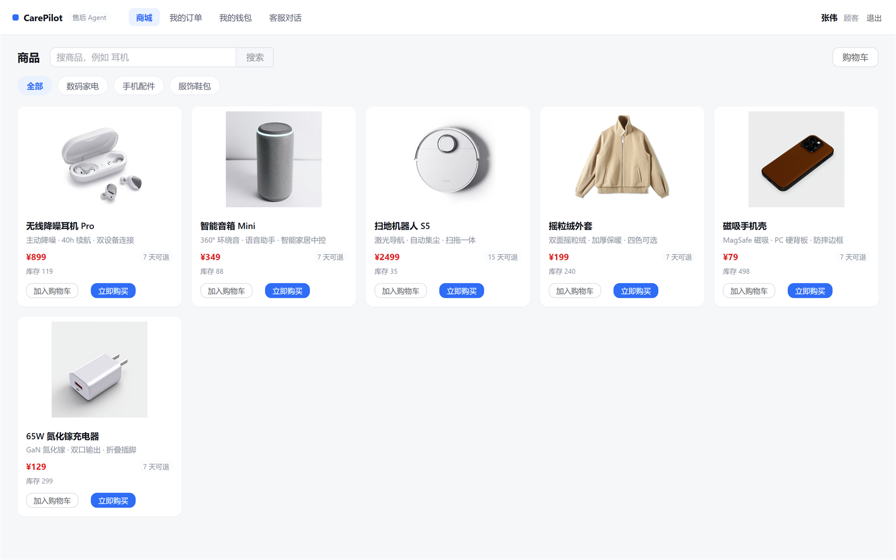
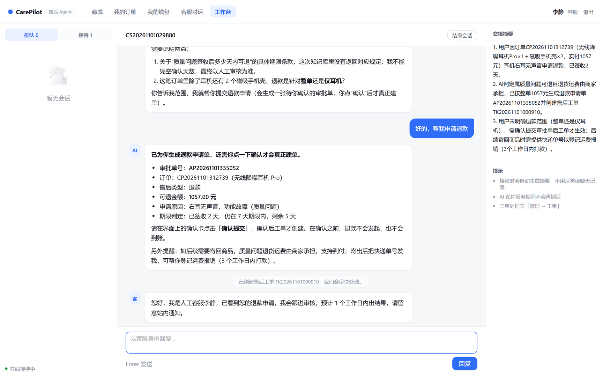
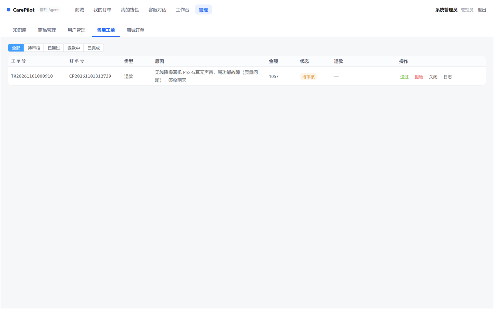
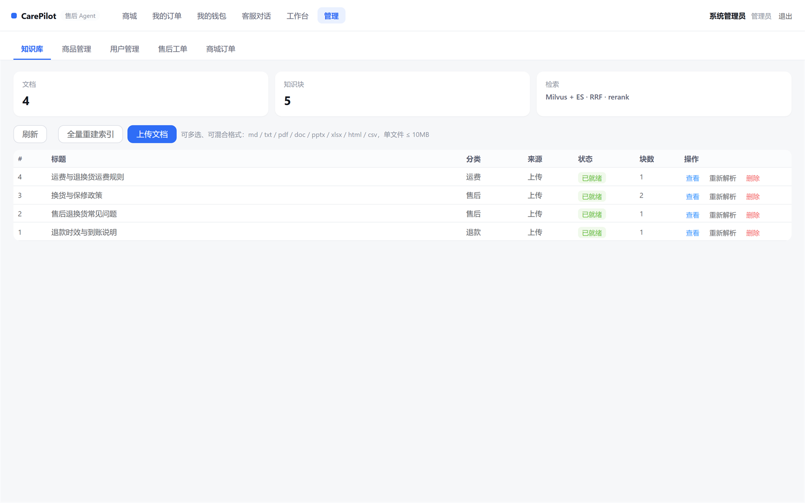
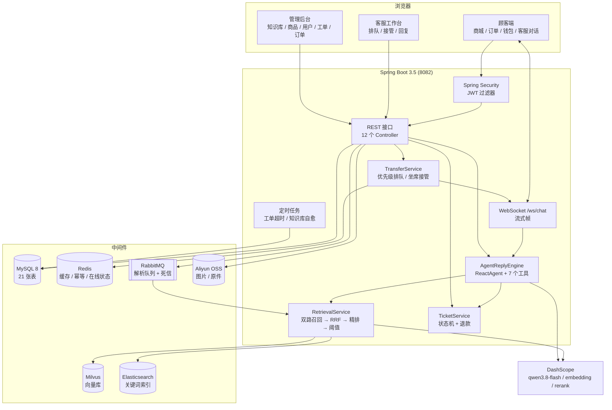

<div align="center">

# CarePilot · 电商售后 Agent 平台

**AI 客服 + 人工坐席 + 售后工单 + 商城，一条链路跑通。**

从「商品下单」到「AI 查订单、查政策、生成退款申请」，再到「转人工排队、坐席接管、工单审核退款」，
全部代码都在这个仓库里，克隆下来就能跑。


</div>

---

## 目录

- [界面预览](#界面预览)
- [这个项目解决什么问题](#这个项目解决什么问题)
- [功能特性](#功能特性)
- [技术栈](#技术栈)
- [系统架构](#系统架构)
- [目录结构](#目录结构)
- [快速开始](#快速开始)
- [配置说明](#配置说明)
- [AI Agent 是怎么做的](#ai-agent-是怎么做的)
- [几个值得看的工程细节](#几个值得看的工程细节)
- [接口一览](#接口一览)
- [数据库表](#数据库表)
- [常见问题](#常见问题)
- [Roadmap](#roadmap)
- [许可证](#许可证)

---

## 界面预览

下面全部是**把项目真正跑起来之后截的图**（后端 8082 + 前端 5175 + 真实的 MySQL/Redis/RabbitMQ/Milvus/ES）。

### AI 客服：查订单、检索政策、生成待确认的退款申请



> 一次真实的对话：模型先调 `queryOrder` 拿订单，再调 `queryAfterSalePolicy` 检索知识库，
> 最后调 `submitAfterSaleRequest` 生成一张**审批单**——它不会直接退款，必须用户点「确认提交」才真正建单。
> 回答底部挂着引用来源和精排分数，右侧是当前顾客的最近订单与工单上下文。

<table>
  <tr>
    <td width="50%"><br/><sub><b>商城</b>：商品、分类、搜索、购物车</sub></td>
    <td width="50%"><br/><sub><b>客服工作台</b>：接管会话、自动交接摘要、以坐席身份回复</sub></td>
  </tr>
  <tr>
    <td width="50%"><br/><sub><b>售后工单</b>：状态机驱动的通过 / 拒绝 / 退款 / 关闭</sub></td>
    <td width="50%"><br/><sub><b>知识库</b>：上传即异步解析，分块 → 向量化 → 建索引</sub></td>
  </tr>
</table>

更多截图（订单、钱包、商城管理、用户管理、排队等待）都在 [`docs/screenshots`](docs/screenshots) 里。

---

## 这个项目解决什么问题

电商售后里最难的不是「把商品卖出去」，而是卖出去之后：

- 顾客问「我的快递到哪了」——客服要切三个系统查订单、查物流；
- 顾客说「我要退款」——客服要判断签收几天了、商品属不属于质量问题、运费谁出、能退多少；
- 判断完还要建工单、等审核、原路退款；
- 遇到情绪激动的顾客，还要能及时转人工，并且转过去之后**坐席不用从头读聊天记录**。

CarePilot 把这套流程做成了一个闭环：**AI 先扛住 80% 的重复咨询，扛不住的带着上下文转人工，人工处理的结果再落成工单和退款流水。**

而为了让这个闭环真的能跑起来，仓库里同时包含了完整的商城前台（下单/支付/收货）、售后工单后台、知识库管理和可观测性配置。

---

## 功能特性

| 模块 | 能力 |
| --- | --- |
| **AI 客服** | 7 个工具（查订单、查物流、翻我的订单、查售后政策、查我的工单、申请售后、转人工）；WebSocket 流式输出；工具调用过程实时可见；回答带知识库引用与精排分数 |
| **Human-in-the-loop** | 涉及「退款/退货/换货」的工具只生成审批单（15 分钟有效），用户点确认才落工单，模型无法自作主张退款 |
| **RAG 知识库** | 上传 md/txt/pdf/doc/docx/pptx/xlsx/html/csv，Tika 解析 → 父子块切分 → DashScope 向量化 → Milvus + Elasticsearch 双路召回 → RRF 融合 → 精排 → 阈值拒答 |
| **转人工** | 按原因分级排队（投诉 100 > 情绪 80 > 退款 50 > 政策 30 > 其它 10），坐席心跳与最大接待数校验，接管时用大模型自动生成交接摘要 |
| **售后工单** | 状态机 `PENDING → APPROVED → REFUNDING → DONE`，另有 `REJECTED`/`CLOSED`；非法流转直接拒绝；超时未处理自动关闭并回滚订单状态 |
| **商城** | 商品/分类/搜索、购物车、收货地址、下单（库存扣减 + 幂等键）、余额支付、发货、确认收货、取消退款回补库存 |
| **钱包** | 余额账户 + 只追加的流水账（充值 / 支付 / 退款），余额快照可对账 |
| **后台管理** | 知识库（上传/预览/重新解析/失败重试/全量重建索引）、商品（含主图与图集上传）、用户（角色、接待上限、重置密码、停用）、工单、订单 |
| **认证与权限** | JWT 双令牌（access 2h / refresh 30d，过期静默续期），USER / AGENT / ADMIN 三角色路由与接口双重校验 |
| **可观测性** | 全链路 traceId（HTTP + WS + MQ 都能串起来）、Actuator + Prometheus 指标（`carepilot.ai.reply`、`carepilot.rag.retrieve` 直方图） |
| **异步与补偿** | 知识库解析走 RabbitMQ，失败重试进死信队列落库，后台可重试；定时任务兜底「卡住」和「超时」的文档/工单 |

代码规模：后端 **146 个 Java 文件 / 约 7.4k 行**（12 个 Controller），前端 **16 个 Vue 文件 / 约 2.4k 行**，数据库 **21 张表**。

---

## 技术栈

| 层 | 选型 |
| --- | --- |
| 后端 | Java 21、Spring Boot 3.5.16、Spring AI 1.1.2、Spring AI Alibaba 1.1.2.0（`ReactAgent`）、MyBatis-Plus 3.5.17、JJWT 0.13.0、springdoc-openapi 2.9.1 |
| 前端 | Vue 3.5（`<script setup>`）、Vite 8、Element Plus 2.14、Pinia 4、Vue Router 5、axios、marked + DOMPurify（Markdown 渲染并消毒） |
| 存储 | MySQL 8（业务数据）、Redis（缓存、幂等键、坐席在线状态）、Aliyun OSS（商品图、知识库原件，可选） |
| 检索 | Milvus 2.5（向量）、Elasticsearch 9 + IK 分词（关键词）、DashScope `qwen3.7-text-embedding-flash` / `qwen3-vl-rerank` |
| 消息 | RabbitMQ（知识库解析异步化 + 死信队列） |
| 可观测 | Actuator、Micrometer、Prometheus、Grafana |
| 文档解析 | Apache Tika 3.2.3 |

---

## 系统架构



### 一条售后消息的处理链路

```text
浏览器 WebSocket (/ws/chat)
  → ChatService.handleSend：会话归属校验 → 幂等落库 → 回 ACK
  → AgentReplyEngine：ReactAgent(系统提示词 v1.6 + 7 个工具)
      ├─ queryOrder           查当前用户订单（越权按不存在处理）
      ├─ queryAfterSalePolicy 走 RAG：Milvus + ES 召回 → RRF → 精排 → 阈值
      └─ submitAfterSaleRequest  只生成审批单，不建单
  → 文本按 12 字切片推 AI_DELTA，前端边收边渲染
  → AI_DONE：带 messageId、引用列表、耗时；消息与引用一起落库
```

---

## 目录结构

```text
carepilot/
├── carepilot-springboot/                 # 后端（Spring Boot）
│   ├── src/main/java/com/carepilot/
│   │   ├── agent/                        # Agent 引擎、提示词、7 个工具、审批
│   │   ├── aftersale/                    # 售后工单：状态机、服务、超时任务
│   │   ├── catalog/                      # 商品与类目（含缓存）
│   │   ├── chat/                         # 会话、消息、WebSocket、转人工、回复引擎
│   │   ├── common/                       # 统一响应、异常、幂等、存储、traceId、ID 生成
│   │   ├── config/                       # MyBatis-Plus、异步线程池、CORS
│   │   ├── knowledge/                    # 知识库：解析、分块、向量、关键词、精排、MQ、任务
│   │   ├── mall/                         # 购物车、地址、下单、支付、退款、余额
│   │   ├── order/                        # 订单查询、物流
│   │   ├── security/                     # JWT、过滤器、权限、登录态
│   │   └── user/                         # 认证、用户管理
│   └── src/main/resources/
│       ├── application.yml               # 主配置（中间件地址默认走 localhost）
│       ├── application-local.example.yml # 私有配置模板（OSS / API Key）
│       ├── prompts/aftersale-agent.st    # 客服系统提示词（带版本号）
│       ├── policies/                     # 演示用售后政策文档（txt/pdf/doc）
│       └── picture/                      # 演示商品图
├── carepilot-vue/                        # 前端（Vue 3 + Vite）
│   └── src/
│       ├── api/                          # axios 封装 + 全部接口
│       ├── components/ChatStream.vue     # 对话流：气泡 / 工具调用 / 审批卡 / 引用
│       ├── layout/AppLayout.vue          # 顶栏与导航
│       ├── stores/auth.js                # 登录态（Pinia）
│       ├── utils/                        # token、WebSocket 客户端、格式化
│       └── views/                        # 商城、订单、钱包、对话、工作台、后台
├── sql/
│   ├── init.sql                          # 建库建表 + 初始管理员
│   └── demo-data.sql                     # 可选演示数据（商品/顾客/客服/订单）
├── docs/screenshots/                     # 项目真实运行截图
├── README.md
└── LICENSE
```

---

## 快速开始

### 1. 环境要求

| 依赖 | 版本 | 是否必需 |
| --- | --- | --- |
| JDK | 21+ | ✅ |
| Maven | 3.9+ | ✅ |
| Node.js | 20+（开发用 24） | ✅ |
| MySQL | 8.0 | ✅ |
| Redis | 7+ | ✅ |
| RabbitMQ | 3.12+ | ✅（知识库异步解析） |
| Milvus | 2.5 | ✅（RAG 向量召回） |
| Elasticsearch | 8+/9 | ✅（关键词召回，中文建议装 IK 分词） |
| DashScope API Key | - | ✅（对话 / 向量 / 精排都走它） |
| 阿里云 OSS | - | ⬜ 可选，不配也能跑，只是图片不落公网 |

> 中间件全部装在同一台机器上时，按默认配置就能连上（MySQL `root/root`、RabbitMQ `admin/admin123`、Redis 无密码、ES/Milvus 无认证）。

### 2. 初始化数据库

```bash
# 建库建表 + 初始管理员 admin / admin123
mysql -h127.0.0.1 -uroot -proot --default-character-set=utf8mb4 < sql/init.sql

# 可选：灌一套演示数据（6 个商品 + 顾客 zhangwei + 客服 lijing + 3 笔订单）
mysql -h127.0.0.1 -uroot -proot --default-character-set=utf8mb4 < sql/demo-data.sql
```

> `--default-character-set=utf8mb4` 别省，Windows 下用 mysql 客户端导入中文很容易变乱码。
> `init.sql` 开头已经写了 `SET NAMES utf8mb4`，加上参数是双保险。

### 3. 配置密钥

```bash
cd carepilot-springboot/src/main/resources
cp application-local.example.yml application-local.yml
# 编辑 application-local.yml，填入 DashScope API Key（OSS 可留空）
```

也可以完全不改文件，直接用环境变量注入：

```bash
export DASHSCOPE_API_KEY=sk-xxxx
export AI_CHAT_MODEL=qwen3.8-flash     # 可选，默认 qwen3.8-max
```

### 4. 启动后端

```bash
cd carepilot-springboot
mvn spring-boot:run
# 或者打包后运行
mvn -DskipTests package && java -jar target/carepilot-1.0.0.jar
```

启动后：

- 接口：<http://localhost:8082>
- Swagger UI：<http://localhost:8082/swagger-ui.html>
- 健康检查：<http://localhost:8082/actuator/health>
- Prometheus 指标：<http://localhost:8082/actuator/prometheus>

### 5. 启动前端

```bash
cd carepilot-vue
npm install
npm run dev        # http://localhost:5175
```

`vite.config.js` 已把 `/api` 和 `/ws` 代理到 `localhost:8082`，前后端分开跑不需要额外配 CORS。

### 6. 登录

| 账号 | 密码 | 角色 | 能做什么 |
| --- | --- | --- | --- |
| `zhangwei` | `123456` | 顾客 | 商城、下单、支付、客服对话、申请售后（`demo-data.sql` 提供） |
| `lijing` | `123456` | 客服 | 工作台排队、接管会话、回复、处理工单（`demo-data.sql` 提供） |
| `admin` | `admin123` | 管理员 | 全部后台 + 工作台（`init.sql` 提供） |

> 顾客也可以直接注册；**客服与管理员账号只能在「管理 → 用户管理」里创建**。

### 7. 让 AI 有知识

后台「管理 → 知识库 → 上传文档」，把 `carepilot-springboot/src/main/resources/policies/` 里的
`常见问题.txt`、`退款时效.txt`、`换货与保修.pdf`、`运费规则.doc` 传上去。
上传后经 RabbitMQ 异步解析，状态变成「已就绪」即可被 Agent 检索到。

---

## 配置说明

### 环境变量（不改代码就能换环境）

| 变量 | 默认值 | 说明 |
| --- | --- | --- |
| `MYSQL_HOST` / `MYSQL_PORT` / `MYSQL_DB` | `localhost` / `3306` / `carepilot` | 数据库 |
| `MYSQL_USERNAME` / `MYSQL_PASSWORD` | `root` / `root` | 数据库账号 |
| `REDIS_HOST` / `REDIS_PORT` | `localhost` / `6379` | 缓存、幂等键、坐席在线状态 |
| `RABBITMQ_HOST` / `RABBITMQ_PORT` | `localhost` / `5672` | 消息队列 |
| `RABBITMQ_USERNAME` / `RABBITMQ_PASSWORD` | `admin` / `admin123` | MQ 账号 |
| `MILVUS_HOST` / `MILVUS_PORT` | `localhost` / `19530` | 向量库 |
| `ES_URL` | `http://localhost:9200` | 关键词索引 |
| `DASHSCOPE_API_KEY` | 空 | 必填，对话 + 向量 + 精排 |
| `AI_BASE_URL` | `https://dashscope.aliyuncs.com/compatible-mode` | OpenAI 兼容端点，可换其它厂商 |
| `AI_CHAT_MODEL` | `qwen3.8-max` | 对话模型 |
| `AI_EMBEDDING_MODEL` | `qwen3.7-text-embedding-flash` | 向量模型 |
| `JWT_SECRET` | 内置开发密钥 | 生产必须换 |

### 业务参数（`application.yml` 的 `carepilot.*`）

| 配置 | 默认 | 含义 |
| --- | --- | --- |
| `carepilot.reply.engine` | `agent` | `agent`=大模型 Agent；`echo`=回声引擎（没有 API Key 时用来跑通链路） |
| `carepilot.jwt.access-ttl` | `7200` | 访问令牌 2 小时 |
| `carepilot.jwt.refresh-ttl` | `2592000` | 刷新令牌 30 天 |
| `carepilot.rag.recall-top-k` | `12` | 每路召回的候选数 |
| `carepilot.rag.final-top-k` | `8` | 精排后给模型的最大条数 |
| `carepilot.rag.rrf-k` | `60` | RRF 融合参数 |
| `carepilot.rag.score-threshold` | `0.75` | 精排分数低于它就**拒答**，宁可说「查不到」也不编 |
| `carepilot.rag.chunk-size` / `chunk-overlap` | `450` / `60` | 分块与重叠 |
| `carepilot.rag.query-rewrite` | `false` | 查询改写，默认关（实测 Hit@3 没提升但延迟涨了 10 倍） |
| `carepilot.rag.rerank.enabled` | `true` | 是否走精排模型 |
| `carepilot.aftersale.pending-timeout-minutes` | `120` | 待审工单超时自动关闭 |
| `carepilot.kb.stuck-timeout-minutes` | `10` | 文档卡住多久后重新投递 |

---

## AI Agent 是怎么做的

### 1. 提示词：先定边界，再谈语气

系统提示词放在 `src/main/resources/prompts/aftersale-agent.st`，带 `version` / `updated` 元信息（`PromptRegistry` 解析），
核心是三条硬规则：

1. **订单、金额、时间、政策条款只能来自工具返回**，查不到就说查不到，禁止编造；
2. **工具返回了条款就必须引用**，不允许在已有条款的情况下敷衍「查不到」；
3. **条款要对得上商品**，找不到对应类目就说无法确认，不能把别的类目规则硬套上去。

另外还写了：不泄露其他用户信息、抵抗「忽略以上指令」类注入、涉及敏感信息主动拒绝。

### 2. 工具：让模型动手，但不让它乱动手

| 工具 | 作用 | 是否写数据 |
| --- | --- | --- |
| `queryOrder` | 按订单号查详情（状态/金额/商品/下单发货签收时间） | 只读 |
| `queryLogistics` | 查物流轨迹与签收时间 | 只读 |
| `listMyOrders` | 用户说不出订单号时，列出最近 10 笔 | 只读 |
| `queryAfterSalePolicy` | 检索售后政策知识库，返回带编号的条款 | 只读 |
| `listMyTickets` | 查当前用户的售后工单 | 只读 |
| `submitAfterSaleRequest` | 申请退款/退货/换货 | **只生成审批单** |
| `transferToHuman` | 转人工（带优先级） | 改会话状态 |

所有工具都通过 `AgentContext` 拿当前登录用户，**越权查询一律按「不存在」返回**，
模型拿到的数据永远是当前顾客自己的。

### 3. 人在环里（Human-in-the-loop）

```text
模型调用 submitAfterSaleRequest
  → 校验订单归属、类型、金额上限、是否已有处理中的工单
  → 落一条 chat_approval（PENDING，15 分钟有效）
  → 前端弹出「需要你确认」卡片
  → 用户点「确认提交」→ TicketService.create 建单（订单置为售后中）
  → 用户点「取消」或超时 → 什么都不发生
```

这样设计的原因很直接：**退款是花钱的操作**。模型可以判断「该不该退」，但「退不退」必须由人拍板。
审批单还有过期时间，避免用户三天后点到一个早已过期的确认。

### 4. RAG：双路召回 + RRF + 精排 + 阈值拒答

```text
问题
 ├─ DashScope embedding → Milvus 向量召回 Top12
 └─ ES + IK 分词       → 关键词召回 Top12
        ↓ RRF 融合（k=60）
        ↓ 取 Top8 交给 qwen3-vl-rerank 精排
        ↓ 分数 >= 0.75 才保留（否则返回「知识库中没有检索到可靠条款」）
        ↓ 命中子块回填父块（parent_content），给模型更完整的上下文
模型回答 + 引用来源（文档标题 / 标题路径 / 片段 / 分数）
```

几个实测结论也写在了配置注释里：

- 开查询改写对 Hit@3 没有提升，但单次检索从 0.4s 涨到 4.4s → 默认关闭；
- 没有精排时只用 RRF，召回要放宽（`final-top-k` 8）才不至于漏掉关键条款；
- 拒答线定在 0.75：相关样本 0.86~0.89，无关样本 0.02~0.65。

### 5. 知识库入库

```text
上传 → 落库(PENDING) + 存 OSS/本地 → 发 RabbitMQ
     → 消费：Tika 解析 → Markdown 分块（父子块）→ 批量 embedding
     → 写 kb_chunk + Milvus + ES → 状态 READY（记录 chunk_count）
失败 → 重试 → 进死信队列 → 落 kb_ingest_failure → 后台可一键重试
兜底 → 每 5 分钟扫一遍卡在 PENDING/PARSING/EMBEDDING 超 10 分钟的文档重新投递
```

### 6. 评测：把效果量化出来

30 条评测集（正向 12 / 同义改写 9 / 负向 9），按「检索命中 + 拒答正确」两个维度打分。

单路召回与双路召回的对比：

| 指标 | 单路召回 | 双路召回 |
| --- | --- | --- |
| 前 5 条召回命中率 | 100% | 100% |
| 负向拒答准确率 | 33.3% | 100% |

加上 RRF 与精排后，又在拒答阈值上做了一轮调参：

| 拒答阈值 | 命中率 | 负向拦截 |
| --- | --- | --- |
| 0.75 | 76.2% | 9 / 9 |
| **0.70** | **95.2%** | **9 / 9** |

0.75 时太多本该答出来的问题被误拒，降到 0.70 后命中率提升 19 个百分点，9 条负向样本仍然全部拦住。检索 P50 424ms。

---

## 几个值得看的工程细节

**1. 幂等下单**
下单接口支持 `Idempotency-Key` 请求头，用 Redis `SETNX` 抢占，10 分钟有效。
重复提交会拿到第一次的订单号（而不是两笔订单）；正在处理中则直接返回 409。

**2. 工单状态机集中管理**
所有流转规则写在 `TicketStatus.TRANSITIONS` 一张表里，业务代码只调 `target(action, from)`。
非法流转（例如已完成的工单再退款）会直接抛异常，不用在每个 Service 里写 if。

**3. 转人工不丢上下文**
排队按「优先级 + 等待时间」排序，坐席每 90 秒心跳一次（Redis TTL），离线自动掉出可接管池；
接管时用大模型把前面几十条对话压成一段交接摘要，坐席不用从头读。

**4. AI 在人工服务期间闭嘴**
会话状态是 `AGENT` 时，用户消息只转发给坐席，不再走大模型；
状态是 `WAITING` 时，只回一个排队位置。避免「用户以为在和机器人聊，其实已经在排队」。

**5. WebSocket 断线要能自愈**
前端 `ChatSocket` 带指数退避重连，重连后**主动补一次数据**（会话列表、消息、排队状态、待审批单）——
因为断线期间的推送丢了，只靠实时帧会让界面停在旧状态。

**6. 模型失败也要说人话**
模型超时、额度不足、内容被拦，都会经 `LlmErrors` 翻译成中文提示并落库，
前端看到的是「AI 服务暂时不可用，可以点右上角转人工」，而不是一段 Java 异常。

**7. 日志能串起来**
HTTP 请求、WebSocket 帧、MQ 消费都会往 MDC 里塞 traceId，日志格式统一带 `[traceId]`，
一次请求穿过 Controller → RAG → MQ 时可以整条捞出来。

**8. 确认动作走条件更新，同一张单只能执行一次**
用户连点、网络重试都可能把同一张审批单提交多次。确认时用条件更新做状态 CAS，
`UPDATE ... SET status='CONFIRMED' WHERE id=? AND status='PENDING'`，
影响行数为 0 直接返回冲突。200 线程并发确认，只有 1 次成功。

---

## 接口一览

所有接口统一返回 `{ code, message, data, timestamp }`，`code = 0` 表示成功，`40100` 表示令牌失效。

| 分组 | 前缀 | 说明 |
| --- | --- | --- |
| 认证 | `/api/auth` | 登录、注册、刷新令牌、当前用户 |
| 客服会话 | `/api/chat` | 会话增删查、消息、转人工、审批 |
| 审批 | `/api/chat/approvals` | 待审批列表、确认、拒绝 |
| 工作台 | `/api/workbench` | 排队/接待列表、接管、回复、交接摘要、工单流转 |
| 商城 | `/api/mall` | 商品、分类、购物车、收货地址 |
| 订单 | `/api/orders` | 下单、列表、详情、支付、取消、确认收货、支付记录 |
| 钱包 | `/api/wallet` | 余额、充值、流水 |
| 后台-商品 | `/api/admin/products` | 增删改查、上下架、主图/图集上传 |
| 后台-订单 | `/api/admin/orders` | 列表、发货 |
| 后台-用户 | `/api/admin/users` | 列表、创建、编辑、启停、重置密码 |
| 后台-知识库 | `/api/admin/kb` | 上传、预览、重新解析、删除、重建索引、失败重试、统计 |
| WebSocket | `/ws/chat?token=...` | `SEND` / `PING`，下行 18 种帧（`AI_DELTA`、`TOOL_CALL`、`APPROVAL`、`QUEUE_STATUS` …） |

完整的请求/响应结构见 <http://localhost:8082/swagger-ui.html>。

---

## 数据库表

| 分组 | 表 |
| --- | --- |
| 用户 | `sys_user` |
| 商品 | `catalog_category`、`catalog_product` |
| 交易 | `order_main`、`order_item`、`logistics_trace`、`pay_record`、`refund_record`、`mall_cart_item`、`mall_address` |
| 资金 | `wallet`、`wallet_ledger`（只追加，可对账） |
| 客服 | `chat_session`、`chat_message`、`chat_approval`、`agent_tool_log`（工具调用审计） |
| 售后 | `after_sale_ticket`、`after_sale_ticket_log` |
| 知识库 | `kb_document`、`kb_chunk`、`kb_ingest_failure` |

---

## 常见问题

**Q：导入 SQL 后中文变成乱码？**
用 `--default-character-set=utf8mb4` 重新导入；`init.sql` 里已经加了 `SET NAMES utf8mb4`。

**Q：启动报连不上 Milvus / ES？**
这两个组件是 RAG 必需的。Milvus 没起来时启动仍会成功，但检索会退化为单路召回；
两个都没起来则 `queryAfterSalePolicy` 会返回「知识库中没有检索到可靠条款」，AI 会如实拒答而不是瞎编。

**Q：没有 DashScope Key 能跑吗？**
能启动，但对话不可用。可以用 `carepilot.reply.engine=echo` 把回声引擎打开，跑通除大模型以外的前后端链路。

**Q：免费额度用完了怎么办？**
换一个有额度/已付费的模型：`AI_CHAT_MODEL=qwen3.8-flash`（实测有免费额度且支持 function calling）。
注意 embedding 与 rerank 是独立计费，只换对话模型不影响检索。

**Q：前端白屏 / 401 循环？**
先确认后端 8082 起来了、`vite.config.js` 的代理没错；再清一次 localStorage（`cp_token` / `cp_refresh_token`）。

**Q：想换别的模型厂商？**
改 `AI_BASE_URL`、`AI_CHAT_MODEL`、`AI_EMBEDDING_MODEL` 即可，代码里用的是 OpenAI 兼容协议。
精排走的是 DashScope 的 `text-rerank` 接口，换厂商需要改 `RerankService`。

---

## Roadmap

- [ ] 补单元测试与集成测试（目前仓库还没有 `src/test`，这是最大的短板）
- [ ] 支付接入真实渠道（现在是余额支付，在线支付通道留了 `ONLINE` 枚举但未实现）
- [ ] 多租户与店铺维度（当前是单店铺模型）
- [ ] 知识库支持增量更新与文档版本
- [ ] 会话质检与大模型回复质量评测集
- [ ] Docker Compose 一键起全套中间件

---

## 许可证

[MIT](LICENSE)

> 本项目用于学习与演示。商城、支付、退款均为本地模拟，**请勿直接用于生产环境**（生产还需要补：真实支付、库存并发压测、审计合规、密钥托管等）。
